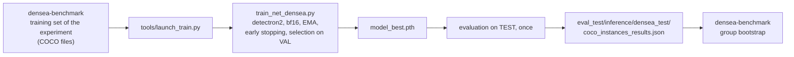

# DenSea DiffusionDet

Training and evaluation code for **DiffusionDet** on **DenSea-Aggregated**, the benchmark used in the article
*When Does Synthetic Data Help Underwater Debris Detection? Gap Metrics, Data Regimes and Detector Paradigms*.
It is a derivative of [ShoufaChen/DiffusionDet](https://github.com/ShoufaChen/DiffusionDet) built on
[detectron2](https://github.com/facebookresearch/detectron2), and sits next to the other two detectors of the study,
[`densea-rtdetrv2`](https://github.com/asferrer/densea-rtdetrv2) and
[`densea-rfdetr`](https://github.com/asferrer/densea-rfdetr). The group-aware partition, the synthetic batches, the
experiment definitions and the bootstrap evaluation are in
[`densea-benchmark`](https://github.com/asferrer/densea-benchmark); this repository is the detector it calls.

> **License.** DiffusionDet is released by its authors under **CC BY-NC 4.0** (non-commercial use). This derivative
> keeps that license, and so do the DenSea-specific files; see [License](#license).

## What changes with respect to upstream

Based on upstream commit [`18b528f`](https://github.com/ShoufaChen/DiffusionDet/commit/18b528f8f84ee6fbf872859fbacf77208413ec81)
(2022-11-19, the head of upstream `main`). The first commit of this repository is that snapshot, so `git diff HEAD~1`
shows exactly what was changed. The details are in [`CHANGES.md`](CHANGES.md); in short:

- **Training script** `train_net_densea.py` (from `train_net.py`): registration of the DenSea-Aggregated splits from
  the annotation files; AMP (bf16 or fp16) and gradient accumulation; model selection and early stopping on the
  validation AP of the EMA weights (`DENSEA.*` options); resume that restores the best value and the patience from
  the evaluation history; periodic checkpoints that keep only every N-th plus the last one; the training mapper
  rescales according to `INPUT.MIN_SIZE_TRAIN`; the learning-rate scheduler and EMA hooks are no longer registered
  twice.
- **Data augmentation** (`diffusiondet/dataset_mapper.py`): albumentations pipeline for underwater images.
- **Numerics**: box decoding and IoU/GIoU computed in fp32 with an epsilon, no assertion on degenerate boxes.
- **Optional speed-ups** (off by default, `DENSEA_FAST_OPT`, `DENSEA_FAST_LOSS`, `DENSEA_FAST_EMA`,
  `DENSEA_NO_SCALER`): parameter groups with foreach gradient clipping, a loss and matcher without CPU/GPU
  synchronisations, a foreach EMA update, and no GradScaler with bf16. They are covered by CPU tests that require
  identical results to the reference path. The launcher turns `DENSEA_FAST_OPT` on.
- **Configs** (`configs/diffdet.densea.*.yaml`) for the 8-class benchmark; tests; `tools/launch_train.py`;
  Dockerfile with detectron2 pinned.
- Removed: the COCO and LVIS configs, the visualization demo and the upstream getting-started notes.

## Workflow

The experiments are defined and evaluated in `densea-benchmark`; this repository trains one detector and writes its detections:



## Installation

detectron2 is a dependency, not part of this repository. It is installed from the commit used for the results:

```bash
pip install -r requirements.txt
pip install --no-build-isolation \
    "git+https://github.com/facebookresearch/detectron2.git@8a9d885b3d4dcf1bef015f0593b872ed8d32b4ab"
```

With Docker (NVIDIA Container Toolkit and a GPU with 24 GB or more; the study used an RTX 5090), which does both steps:

```bash
DATA_ROOT=/path/to/densea_aggregated RUNS_DIR=/path/to/runs docker compose up -d --build
docker exec -it densea_diffusiondet bash
```

Python 3.11 and PyTorch 2.7.0 with CUDA 12.8 were used; `requirements.txt` lists the pinned versions.

## Data

Download **DenSea-Aggregated** (*DenSea-Aggregated: A Group-Aware Benchmark for Underwater Debris Detection*) from the [dataset page of the University of Alicante group](https://www.dlsi.ua.es/~jgallego/datasets/) and unpack it. It contains
`annotations/{train,val,test}.json` (COCO, 8 classes, with a `group` per image) and the `images/` folder, and
`file_name` entries are relative to the package root. The partition is by groups of near-duplicate images, so no
group appears in two splits (995 / 204 / 217 groups; 10,245 / 2,185 / 2,207 images). The three annotation files and
the image root are given to the launcher; the synthetic batches and the training set of each experiment come from
`densea-benchmark`, which writes annotation files in the same format.

## Training and evaluation

```bash
R=/data/densea_aggregated
python tools/launch_train.py \
    --train-json $R/annotations/train.json --val-json $R/annotations/val.json \
    --test-json $R/annotations/test.json --image-root $R --output-dir runs/real_only --seed 21
```

The protocol is the same as for the other two detectors: up to 200 epochs (DiffusionDet trains by iterations, so
`MAX_ITER = 200 x ceil(N / 8)`), batch size 8, AdamW with a learning rate of 5e-5 (5e-6 in the backbone), weight
decay 0.05, cosine schedule with 2,000 warm-up iterations, EMA 0.9998, bf16, ResNet-50 initialised from ImageNet,
300 proposals, one sampling step, evaluation on the validation split once per epoch, `model_best.pth` = best
AP@[.5:.95] of the EMA weights, early stopping after 20 evaluations without an improvement of 0.001. The test split is
evaluated once at the end with `model_best.pth`; the detections are written to
`runs/real_only/eval_test/inference/densea_test/coco_instances_results.json` (at most 100 per image). Group-bootstrap
confidence intervals and the comparison between strategies come from the evaluation scripts of `densea-benchmark`.
Training resumes from the last checkpoint if `--output-dir` already has one. The configuration is
`configs/diffdet.densea.res50.yaml`; ResNet-101 and Swin variants (`configs/diffdet.densea.res101.yaml`,
`swintiny`, `swinsmall`, `swinbase`) use the same settings, but are not part of the reported results (Swin needs the
ImageNet checkpoint converted to the detectron2 format under `models/`).

CPU tests: `CUDA_VISIBLE_DEVICES= python -m pytest -q tests`.

Dataset locations can also be set with the environment variables `DENSEA_DATA_ROOT`, `DENSEA_TRAIN_JSON`,
`DENSEA_VALID_JSON`, `DENSEA_TEST_JSON` and `DENSEA_IMAGE_ROOT` when `train_net_densea.py` is called directly.

## Expected results

AP@[.5:.95] (x100) of DiffusionDet (ResNet-50), mean of three training seeds (21, 22, 23) with 95 % confidence
intervals from a bootstrap over groups (2,000 resamples). The three arms are: Real-Only, Minority-Focus (clean backgrounds; synthetic objects of the rare classes) and Standard (copy-paste; all synthetic images added).

| Arm | Validation AP | AP50 | AP75 | Test AP | AP50 | AP75 |
|---|---|---|---|---|---|---|
| Real-Only | 33.30 [30.11; 37.81] | 55.56 | 34.98 | 34.11 [31.83; 38.08] | 57.26 | 36.31 |
| Minority-Focus (clean backgrounds) | 35.15 [31.56; 39.86] | 58.24 | 37.58 | 36.05 [33.09; 40.49] | 60.50 | 38.41 |
| Standard (copy-paste) | 35.29 [31.38; 40.15] | 55.49 | 38.24 | 35.41 [32.92; 39.21] | 56.15 | 38.50 |

The standard deviation between seeds is 0.24 to 0.73 AP. Differences with respect to Real-Only on test:
Minority-Focus +1.93 AP (95 % CI [+0.09; +3.58]) and Standard (copy-paste) +1.29 AP (95 % CI [-0.37; +2.31]). The
numbers above are the reference for a reproduction on the same partition; small differences between seeds are
expected.

## Citation

If you use this code, please cite the article, the dataset and DiffusionDet:

```bibtex
@article{sanchezferrer2026synthetic,
  title   = {When Does Synthetic Data Help Underwater Debris Detection? Gap Metrics, Data Regimes and Detector Paradigms},
  author  = {S{\'a}nchez-Ferrer, Alejandro and Gallego, Antonio Javier and Calvo-Zaragoza, Jorge},
  journal = {Neurocomputing},
  year    = {2026},
  note    = {Manuscript in preparation}
}

@dataset{sanchezferrer2026densea,
  title     = {{DenSea-Aggregated}: A Group-Aware Benchmark for Underwater Debris Detection},
  author    = {S{\'a}nchez-Ferrer, Alejandro and Gallego, Antonio Javier and Calvo-Zaragoza, Jorge},
  year      = {2026},
  publisher = {University of Alicante},
  url       = {https://www.dlsi.ua.es/~jgallego/datasets/}
}

@inproceedings{chen2023diffusiondet,
  title     = {{DiffusionDet}: Diffusion Model for Object Detection},
  author    = {Chen, Shoufa and Sun, Peize and Song, Yibing and Luo, Ping},
  booktitle = {ICCV},
  year      = {2023}
}
```

## License

The code of DiffusionDet, and therefore this derivative, is licensed under the **Creative Commons
Attribution-NonCommercial 4.0 International** license (see [`LICENSE`](LICENSE)): it may be used and adapted for
non-commercial purposes only, with attribution. The files written for DenSea (configs, launcher, tools, tests, Docker files) are offered under the same license for consistency; upstream's license is not changed. [`NOTICE`](NOTICE) lists the origin of the code it builds on
(Sparse R-CNN and detectron2, Apache-2.0; DETR, Apache-2.0; Swin Transformer, MIT). detectron2 is installed
separately and keeps its own Apache-2.0 license.
